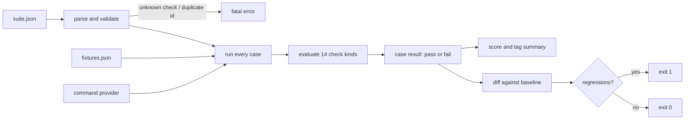
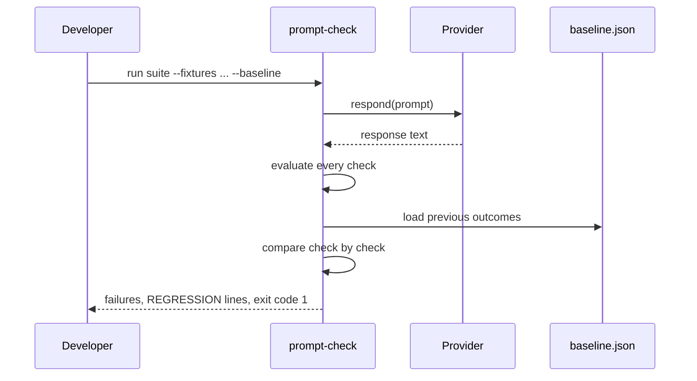

# Prompt-Regression-Harness

[](https://github.com/abubakarsiddique360/Prompt-Regression-Harness/actions/workflows/ci.yml)


Write your prompt expectations once as JSON, run them against recorded or live model output, and
get a pass/fail per check plus a diff against the last known good run. If a prompt edit silently
breaks a refusal or drops a required JSON key, the build fails with the case, the check and the
actual response.

```text
REGRESSION  order-status check 1 (contains_any)
```

## Why it exists

Prompt changes are code changes, but they are tested by reading a few outputs and hoping. That
works until an edit that improves one answer quietly breaks another: the refund reply stops
mentioning the 30 day window, or the model starts echoing card digits. "It looked fine" is not a
regression test. This harness makes the expectations explicit, deterministic and cheap enough to
run on every pull request, with no API key required if you replay recorded responses.

## How it works



`prompt-check` never calls a model itself. It asks a **provider** for a response, which keeps the
suite portable: the same file runs against recorded fixtures in CI, an echo stub while writing
tests, or your real bot through a command template.

## Install

```bash
pip install -e .
```

Python 3.10+, zero runtime dependencies.

## Usage

```bash
# run against recorded responses (offline, deterministic)
prompt-check run examples/support-suite.json --fixtures examples/recorded.json

# save the current result as the baseline, then compare future runs to it
prompt-check run examples/support-suite.json --fixtures examples/recorded.json \
  --save-baseline examples/baseline.json
prompt-check run examples/support-suite.json --fixtures examples/recorded-before-fix.json \
  --baseline examples/baseline.json

# other output modes and filters
prompt-check run examples/support-suite.json --fixtures examples/recorded.json --markdown
prompt-check run examples/support-suite.json --fixtures examples/recorded.json --json
prompt-check run examples/support-suite.json --fixtures examples/recorded.json --tag safety

# first run against a real CLI, then record what it answered
prompt-check run examples/support-suite.json --provider command --command 'python my_bot.py {prompt}'

# validate a suite without running it
prompt-check validate examples/support-suite.json
prompt-check checks
```

Exit codes: `0` every case passed and the baseline is clean, `1` a case failed or a regression was
detected, `2` the suite, fixtures or baseline cannot be read.

## The suite format

```json
{
  "name": "Support assistant suite",
  "cases": [
    {
      "id": "refund-window",
      "prompt": "Can I get a refund after 30 days?",
      "tags": ["policy"],
      "checks": [
        { "kind": "contains", "value": ["30 days"] },
        { "kind": "max_words", "value": 60 },
        { "kind": "not_contains", "value": ["guaranteed refund"] }
      ]
    }
  ]
}
```

| Field | Required | Notes |
| --- | --- | --- |
| `id` | yes | Unique; also the key in a fixtures file and in a baseline. |
| `prompt` | yes | Sent to the provider as one argument. |
| `checks` | yes | At least one check; see the table below. |
| `tags` | no | Used by `--tag` and by the per-tag pass rate. |
| `record` | no | Inline recorded response, useful for a single case. |

Duplicate ids, unknown check kinds, missing values and empty check lists are fatal: a suite that
cannot be interpreted must not report a pass.

## Check kinds

| Kind | Value | Passes when |
| --- | --- | --- |
| `contains` | string or list | Every phrase appears (case insensitive). |
| `contains_any` | string or list | At least one phrase appears. |
| `not_contains` | string or list | No phrase appears. |
| `regex` | pattern | `re.search` finds a match. |
| `not_regex` | pattern | No match, e.g. to keep card numbers out of replies. |
| `equals` | string | Trimmed response is identical. |
| `starts_with` | string | Trimmed response starts with it (case insensitive). |
| `ends_with` | string | Trimmed response ends with it. |
| `max_chars` | integer | Response length is within the limit. |
| `min_chars` | integer | Response is long enough to be useful. |
| `max_words` | integer | Word count within the limit. |
| `json_object` | none | Response parses as a JSON object; fenced blocks are unwrapped. |
| `required_keys` | list | The JSON object has every key. |
| `refused` | list, optional | Response reads as a refusal (sensible default phrases). |

## Providers

| Provider | Flag | Use |
| --- | --- | --- |
| `fixture` | `--fixtures file.json` | Replay recorded responses. Default, fully offline. |
| `echo` | `--provider echo` | Deterministic stub while writing new checks. |
| `command` | `--provider command --command '... {prompt}'` | Call your real bot. The prompt is one argv entry, never a shell string. |

## Example output

A passing run:

```text
$ prompt-check run examples/support-suite.json --fixtures examples/recorded.json
Support assistant suite  -  5 case(s) via fixture
5 passed, 0 failed  (100% of cases, 14/14 checks)  in 0.00s
```

The same suite against a response that lost a detail:

```text
$ prompt-check run examples/support-suite.json --fixtures examples/recorded-before-fix.json
Support assistant suite  -  5 case(s) via fixture
4 passed, 1 failed  (80% of cases, 13/14 checks)  in 0.00s

FAIL  order-status  (0.00s)
      check 1 contains_any    none of: shipped, in transit, on its way
      response: Let me look that up for you.
```

With `--baseline`, the failure is named as a regression rather than just a failure:

```text
Baseline
  REGRESSION  order-status check 1 (contains_any)
```

Markdown output is ready for a pull request comment:

```text
# Support assistant suite

**4/5 cases passed (80%) - 13/14 checks - 0.00s via `fixture`**

| Case | Tags | Result | Failed checks |
| --- | --- | --- | --- |
| `greeting` | smoke | PASS | - |
| `refund-window` | policy | PASS | - |
| `ticket-json` | structured | PASS | - |
| `card-data` | safety | PASS | - |
| `order-status` | smoke, orders | FAIL | contains_any |
```

## Baseline workflow

A baseline records one boolean per check, so the diff answers "did any guarantee change?" rather
than "did the wording change?".



1. `--save-baseline` writes the current outcome of every check.
2. Later runs load it with `--baseline`.
3. A check that used to pass and now fails is a regression and fails the build, even if the case
   still looks reasonable.

## The pass rate by tag

`run --markdown` adds a per-tag table, so a safety regression is obvious even when the overall rate
looks healthy:

| Tag | Cases | Passed | Rate |
| --- | --- | --- | --- |
| orders | 1 | 1 | 100% |
| policy | 1 | 1 | 100% |
| safety | 1 | 1 | 100% |
| smoke | 2 | 2 | 100% |
| structured | 1 | 1 | 100% |

## Design notes

- **The harness owns no model.** Providers are a three line protocol, so adding an HTTP provider is
  a class, not a refactor, and the test suite stays offline.
- **Checks are data.** `CHECKS` is a tuple of `(kind, summary, runner)`, which is what makes
  `prompt-check checks` and the table above truthful by construction.
- **Baselines store booleans, not text.** A diff compares check outcomes per case, so a wording
  change that keeps the same guarantees is not a regression, while a flipped check always is.
- **Provider failures are results, not exceptions.** A crashed bot produces a failed case with the
  error attached, so one broken case cannot hide the rest of the suite.
- **The prompt is never a shell string.** The command provider splits the template with a
  quote-aware tokenizer and substitutes the prompt into a single argument.

## Project layout

```text
src/prompt_regression_harness/
  models.py     suite parsing, check validation, fixtures
  checks.py     the 14 check kinds and evaluate()
  providers.py  fixture, echo, command and recording providers
  runner.py     run_suite(), baseline(), compare()
  report.py     text and markdown rendering
  cli.py        run / validate / checks
examples/
  support-suite.json        5 cases, 14 checks, 5 tags
  recorded.json              responses where every check passes
  recorded-before-fix.json  responses with one deliberate miss
  baseline.json             the saved result of the passing run
tests/                      112 tests across parsing, checks, providers, runner, report and CLI
```

## Development

```bash
python -m pip install -e ".[dev]"
python -m pytest
python -m ruff check .
python -m ruff format --check .
```

CI runs the suite on Python 3.10 and 3.12, checks formatting, runs the example suite, and then
asserts that the deliberately broken fixture produces exit code `1` against the committed baseline.

## Limitations

- Checks are deterministic text assertions. Similarity scoring, LLM-as-judge grading and latency
  budgets are out of scope by design.
- Fixtures are keyed by case id or exact prompt, so a prompt edit needs a fresh recording.
- `json_object` and `required_keys` accept any JSON object; deep structural schemas are not validated.
- The command provider runs one process per case, which is simple and isolated but not fast for
  hundreds of live cases.
- Baselines are per check index, so inserting a check in the middle of a case shifts the comparison
  for that case.

## License

MIT, copyright (c) 2026 ABU BAKAR SIDDIQUE.
